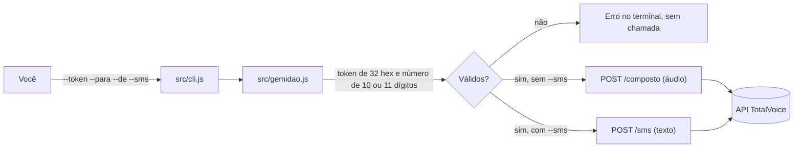

<div align="center">

# Gemidão do Zap

**Liga para alguém e toca o gemidão do Zap na linha dela.**<br/>
Uma chamada ou um SMS por comando, com token e número validados antes de qualquer envio.

[](https://www.npmjs.com/package/gemidao-do-zap)
[](https://github.com/juninmd/gemidao-do-zap/actions/workflows/validate.yml)
[](LICENSE)

<br/>


</div>

> O brasileiro precisa ser estudado.
>
> Comando para começar: `gemidao-do-zap --para=<numero-da-vitima> --token=<seu-token>`

## O que é isso?

O _Gemidão do Zap_ é uma aplicação escrita sobre o NodeJS que permite que você
envie o gemidão do zap para seus amigos via chamada telefônica e simulando o
número telefônico de pessoas conhecidas.

Por exemplo, eu posso enviar o gemidão do zap para meu amigo simulando uma
ligação da mãe dele e, quando ele atender, _AAAWN OOOWN NHAAA AWWWWN AAAAAH_
(inclusive, você acabou de cair no gemidão do zap escrito).

## Como funciona?

Utilizamos a API de chamadas da *TotalVoice*. Você precisa criar uma conta
para poder utilizar. Quando você cria uma conta, você obtém, gratuitamente, para
fins de testes, R$ 3,00 para utilizar. Cada envio do gemidão debita R$ 0,35.

[Clique aqui para criar sua conta](https://api2.totalvoice.com.br/painel/signup.php)

Você receberá um token de acesso, que poderá passar para a nossa API para
fazer as chamadas. Fique tranquilo, todo o código é aberto e não a salvaremos.



- Validação antes da rede: o token precisa ter 32 caracteres hexadecimais e `--para` 10 ou 11 dígitos; caso contrário a API nem é chamada (`src/gemidao.js`).
- O áudio não viaja pelo CLI: a chamada manda para a TotalVoice a URL do `resources/gemidao.mp3` no repositório original, branch `master`.

## Do que eu preciso?

Do `node` acima da **versão 6**.

## Instalação

```sh
sudo npm install -g gemidao-do-zap   # instala o comando globalmente
gemidao-do-zap --version             # 0.1.2
```

Você terá disponível globalmente o comando `gemidao-do-zap`.

### Parâmetros

| Parâmetro | Obrigatório        | Descrição                                                 |
|-----------|--------------------|-----------------------------------------------------------|
| `--token` | :white_check_mark: | Seu token de acesso do TotalVoice                         |
| `--de`    |                    | Quem está enviando o gemidão? Qualquer número telefônico! |
| `--para`  | :white_check_mark: | Quem é a vítima do gemidão do zap?                        |
| `--sms`   |                    | Se definido, será enviado um SMS ao invés de uma chamada  |

Saída real de `gemidao-do-zap --help`:

```text
Uso: gemidao-do-zap --de=<de> --para=<para>

Opções:
  --token    Token do TotalVoice                          [string] [obrigatório]
  --de       Que número deve ligar?                                     [string]
  --para     Qual o número da vítima?                     [string] [obrigatório]
  --sms      Se definido, será enviado um SMS ao invés de uma chamada  [boolean]
  --help     Exibe ajuda                                               [boolean]
  --version  Exibe a versão                                            [boolean]
```

### Exemplo

```sh
gemidao-do-zap --de=<seu-numero> --para=<numero-da-vitima> --token=<seu-token>
```

<!-- TODO(screenshot): terminal com a saída de uma chamada real; não capturada porque executar o comando faz uma ligação de verdade -->

Observações:

- Somente chamadas brasileiras. Omita o `+55`
- A função de SMS é _alpha_. Por enquanto, funciona somente para o número cadastrado

A vítima receberá uma ligação e, quando atender, ouvirá o delicioso gemido do zap!

Saída real sem rede, com token inválido (não gera chamada):

```text
$ gemidao-do-zap --para=11999999999 --token=abc
 ✗ Erro: Token inválido. Obtenha um em https://totalvoice.com.br
```

### Cadê o áudio?

O arquivo encontra-se [neste link](http://prtnsrc.com/2545.mp3). Abra por sua conta e risco!

A cópia versionada no repositório está em [`resources/gemidao.mp3`](resources/gemidao.mp3).

## Por quê!?

Porque somos brasileiros!


## Limitações conhecidas

- Somente chamadas brasileiras: omita o `+55`.
- O SMS é _alpha_ e funciona somente para o número cadastrado na conta TotalVoice.
- Cada envio debita créditos da conta TotalVoice.
- O áudio é buscado pela TotalVoice na URL fixa `https://github.com/haskellcamargo/gemidao-do-zap/raw/master/resources/gemidao.mp3`; a chamada depende dessa URL continuar disponível.
- Erros de validação (token ou número inválido) são impressos, mas o processo termina com código `0`. Scripts não devem depender do código de saída.
- O `package.json` não define script de testes; o único script de qualidade é o lint (`yarn lint`).

## Desenvolvimento

Requer `node` 6 ou superior e `yarn` (v1), pelo `yarn.lock`.

```sh
yarn install          # instala as dependências pelo yarn.lock
yarn build            # compila src/ para dist/ com Babel
yarn lint             # roda o xo sobre src/
node dist/cli.js --help   # mostra a ajuda local, sem fazer chamada
```

## Contribuindo

Veja [`github/CONTRIBUTING.md`](github/CONTRIBUTING.md).

## Disclaimer

Os autores deste projeto não possuem qualquer ligação com a TotalVoice.
TotalVoice é uma marca registrada.

## Licença

MIT © 2017 Marcelo Camargo. Veja [LICENSE](LICENSE).
